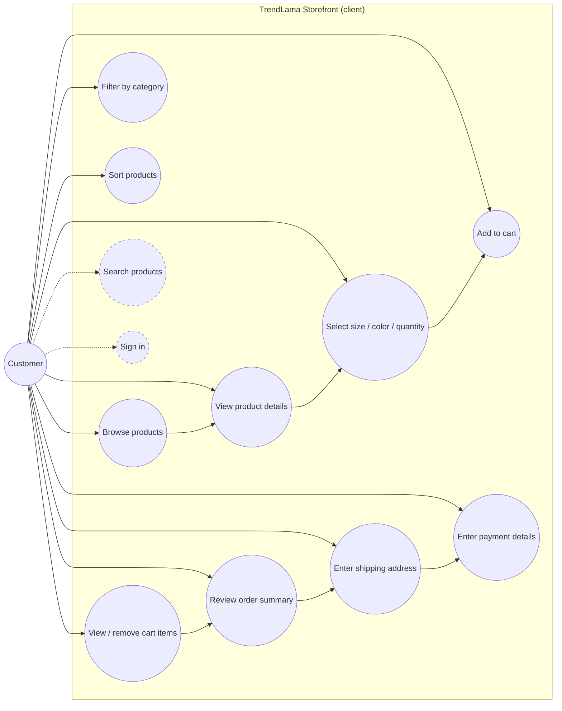
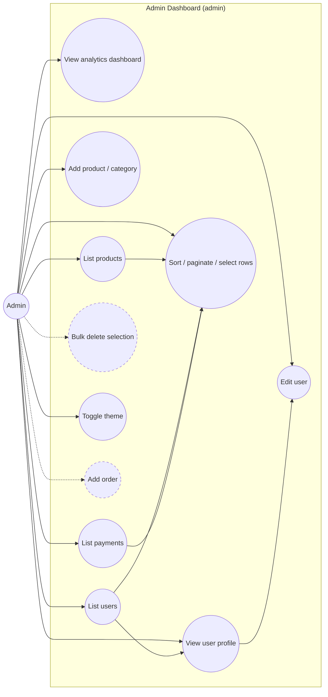
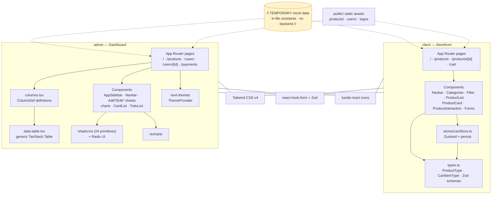
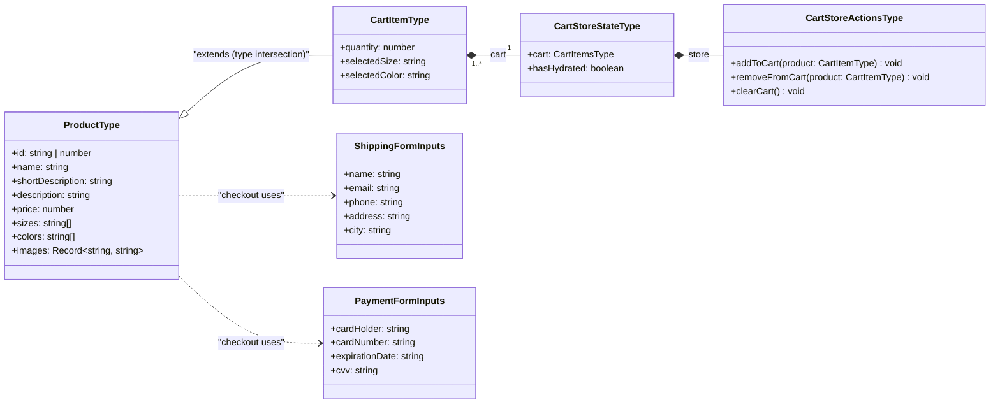
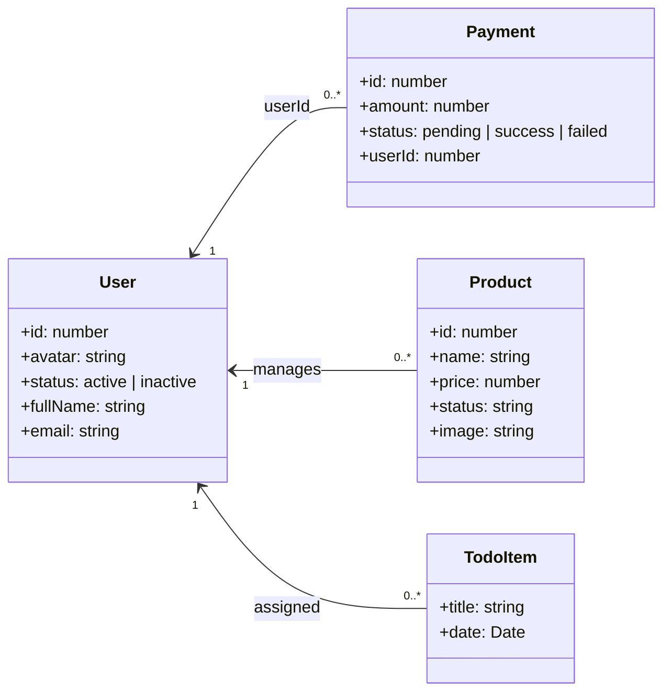
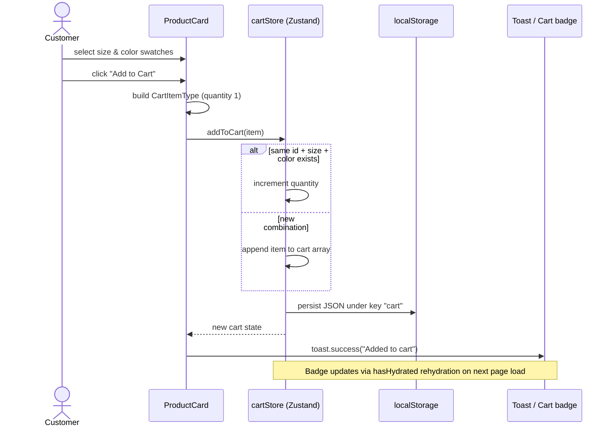
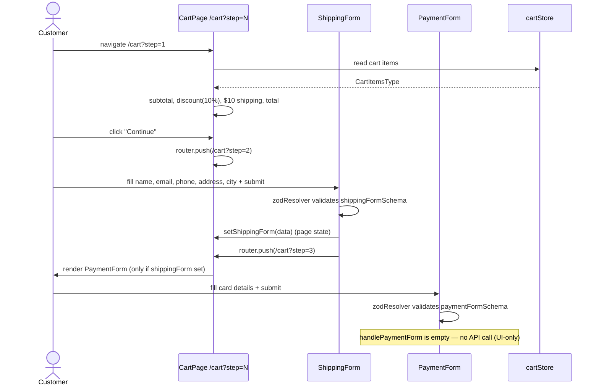
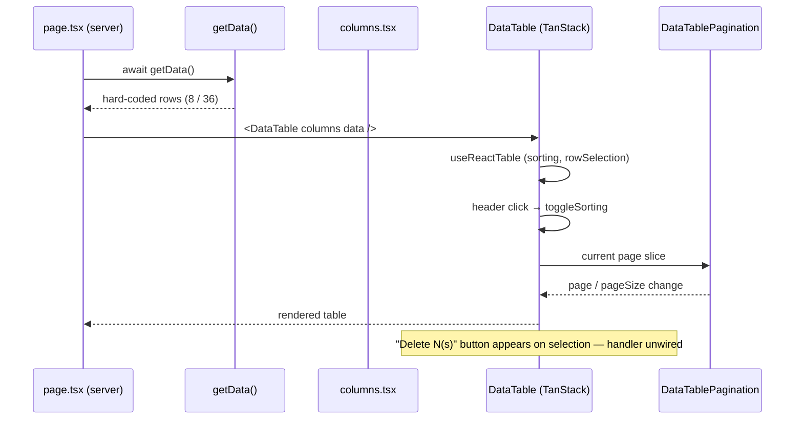
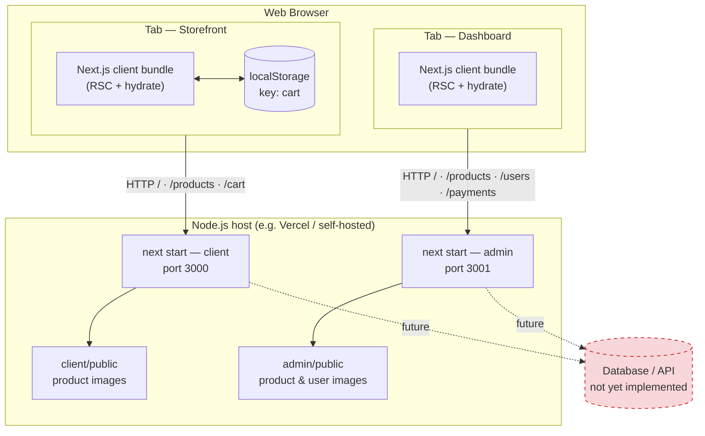

# E-Commerce UI — TrendLama

A **UI-only e-commerce prototype** built as two independent **Next.js 15** applications: a customer **storefront** (`client/`) and an **admin dashboard** (`admin/`). The repository ships with zero backend — all data is mocked in-file (marked `// TEMPORARY`), making it a clean foundation for learning Next.js App Router patterns or wiring up a real API.


---

## Table of Contents

- [Overview](#overview)
- [Tech Stack](#tech-stack)
- [Repository Structure](#repository-structure)
- [Getting Started](#getting-started)
- [Client Storefront](#client-storefront)
- [Admin Dashboard](#admin-dashboard)
- [UML Diagrams](#uml-diagrams)
  - [1. Use Case Diagrams](#1-use-case-diagrams)
  - [2. Component Diagram](#2-component-diagram)
  - [3. Class Diagrams](#3-class-diagrams)
  - [4. Sequence Diagrams](#4-sequence-diagrams)
  - [5. Deployment Diagram](#5-deployment-diagram)
- [Architecture Patterns](#architecture-patterns)
- [Known Gaps & Good First Issues](#known-gaps--good-first-issues)
- [Contributing](#contributing)

---

## Overview

| | |
|---|---|
| **What** | Two front-end apps: a shop where customers browse products and check out, and a dashboard where admins inspect products, users, payments and analytics. |
| **How** | Each app is a standalone Next.js App Router project with its own `package.json`, lockfile and dev server. |
| **Data** | Fully mocked in component/page files — no `fetch`, no database, no API routes. The seam where a real API plugs in is explicitly marked in the code. |
| **Persistence** | Only the shopping cart persists, via Zustand `persist` → `localStorage`. |

**Client features** — category browsing, sort filter, product detail with size/color/quantity selection, persistent cart with badge count, and a 3-step checkout (cart → shipping → payment) with Zod-validated forms.

**Admin features** — analytics dashboard (bar/area/line/pie charts), sortable/paginated tables for products, users and payments with row selection, a single-user profile page, and side-sheet forms for adding products, categories, users and orders, plus light/dark/system theming.

---

## Tech Stack

| Concern | `client/` (Storefront) | `admin/` (Dashboard) |
|---|---|---|
| Framework | Next.js **15.4.5** (App Router, Turbopack) | Next.js **15.3.0** (App Router, Turbopack) |
| UI library | React **19.1** | React **19** |
| Language | TypeScript 5 | TypeScript 5 |
| Styling | Tailwind CSS **v4** | Tailwind CSS **v4** + `tw-animate-css` |
| Components | Hand-rolled components | **shadcn/ui** (new-york, Radix primitives) |
| State | **Zustand** + `persist` (localStorage) | React state + shadcn contexts |
| Tables | — | **TanStack Table v8** |
| Charts | — | **Recharts** (wrapped by shadcn `chart.tsx`) |
| Forms | **react-hook-form** + **Zod v4** | **react-hook-form** + **Zod v3** |
| Toasts | react-toastify | — |
| Theming | — | next-themes (light/dark/system) |
| Icons | lucide-react | lucide-react |
| Package manager | pnpm | pnpm |

---

## Repository Structure

```
e-commerce-ui/
├── client/                          # Customer storefront ("TrendLama")
│   ├── package.json                 # name: ecomgithub
│   ├── public/                      # logo, featured/klarna/cards/stripe images, products/
│   └── src/
│       ├── types.ts                 # ProductType, CartItemType + Zod schemas
│       ├── app/
│       │   ├── page.tsx             # "/"          homepage
│       │   ├── layout.tsx           # Navbar + Footer + ToastContainer
│       │   ├── cart/page.tsx        # "/cart"      3-step checkout (client)
│       │   └── products/
│       │       ├── page.tsx         # "/products"  catalog
│       │       └── [id]/page.tsx    # "/products/:id" detail
│       ├── components/              # Navbar, Footer, ProductCard, ProductList,
│       │                            # Categories, Filter, ProductInteraction,
│       │                            # ShippingForm, PaymentForm, ShoppingCartIcon…
│       └── stores/cartStore.ts      # Zustand cart (persist → localStorage)
│
└── admin/                           # Admin dashboard (shadcn-style)
    ├── package.json                 # name: shadcn
    ├── components.json              # shadcn CLI config
    ├── public/                      # logo, products/, users/
    └── src/
        ├── app/
        │   ├── page.tsx             # "/"                analytics dashboard
        │   ├── layout.tsx           # Theme > Sidebar + Navbar shell
        │   ├── products/page.tsx    # "/products"        table + columns + data-table
        │   ├── users/
        │   │   ├── page.tsx         # "/users"           table
        │   │   └── [id]/page.tsx    # "/users/:id"       profile
        │   └── payments/page.tsx    # "/payments"        table
        ├── components/
        │   ├── AppSidebar.tsx       # main navigation
        │   ├── Navbar.tsx           # topbar (theme toggle, avatar)
        │   ├── Add*/Edit*           # Sheet-based forms (Product, Category, User, Order)
        │   ├── App{Bar,Area,Line,Pie}Chart.tsx
        │   ├── CardList.tsx, TodoList.tsx, TablePagination.tsx
        │   └── ui/                  # 24 shadcn primitives
        ├── hooks/use-mobile.ts
        └── lib/utils.ts             # cn() helper
```

> The two apps share **no code** — each keeps its own copy of the product mock data and images. They are connected only conceptually, through the shared data shapes described in the [class diagrams](#3-class-diagrams).

---

## Getting Started

**Prerequisites:** [Node.js](https://nodejs.org) 20.19+ (Next.js 15 requirement) and [pnpm](https://pnpm.io) (`corepack enable pnpm`).

> **Node version note:** prefer a Node **22 or 24 LTS** release. Node ≥25 enables an experimental server-side `localStorage` stub, which makes libraries that detect storage via `typeof localStorage` throw `localStorage.getItem is not a function` during SSR. If you must stay on Node 25, start the dev servers with `NODE_OPTIONS=--no-experimental-webstorage` to disable the stub.

```bash
git clone https://github.com/safak/e-commerce-ui.git
cd e-commerce-ui
```

Run each app in its own terminal:

```bash
# Terminal 1 — storefront on http://localhost:3000
cd client
pnpm install
pnpm dev
```

```bash
# Terminal 2 — dashboard on http://localhost:3001
cd admin
pnpm install
pnpm dev -- -p 3001
```

Other scripts (both apps): `pnpm build`, `pnpm start`, `pnpm lint`.

---

## Client Storefront

### Routes

| Route | File | Rendered as | Purpose |
|---|---|---|---|
| `/` | `src/app/page.tsx` | Server | Hero banner + product grid, filtered by `?category=` |
| `/products` | `src/app/products/page.tsx` | Server | Catalog with `Categories` + `Filter` sidebar, `?category=` / `?sort=` |
| `/products/[id]` | `src/app/products/[id]/page.tsx` | Server | Detail view, `?color=` / `?size=` select the shown variant |
| `/cart` | `src/app/cart/page.tsx` | Client | 3-step checkout driven by `?step=1\|2\|3` |

### Key behaviors

- **URL-as-state** — category, sort, size, color and checkout step live in query parameters (`useSearchParams` + `router.push`), which keeps page components as server components.
- **Cart** — `stores/cartStore.ts` (Zustand + `persist`, storage key `cart`). `addToCart` merges duplicates by `id + selectedSize + selectedColor`; `ShoppingCartIcon` waits for `hasHydrated` before rendering (SSR-safe).
- **Checkout** — step 1 reads the store and computes subtotal/discount/shipping/total; step 2 validates shipping via `shippingFormSchema` and stores it in page state; step 3 renders `PaymentForm` only after shipping was captured.

---

## Admin Dashboard

### Routes

| Route | File | Purpose |
|---|---|---|
| `/` | `src/app/page.tsx` | Dashboard: revenue bar chart, latest transactions, browser pie chart, todo list, visitors area chart, popular products |
| `/products` | `src/app/products/page.tsx` | 8 products — sortable/paginated table with row selection |
| `/users` | `src/app/users/page.tsx` | 36 users — same table pattern |
| `/users/[id]` | `src/app/users/[id]/page.tsx` | User profile: badges, info card, edit sheet, activity line chart |
| `/payments` | `src/app/payments/page.tsx` | 36 payments — same table pattern |

### The 3-file table pattern

Every entity (`payments/`, `products/`, `users/`) repeats one trio:

1. **`page.tsx`** (server) — async `getData()` returns hard-coded rows → `<DataTable columns data />`
2. **`columns.tsx`** (client) — declarative `ColumnDef[]`: select checkbox, image column, sortable header, status badge, actions dropdown
3. **`data-table.tsx`** (client) — generic TanStack table: sorting, pagination, row selection → `DataTablePagination`

### Forms & theming

- **Sheet CRUD** — sidebar button opens a Radix `Sheet` containing a react-hook-form + Zod form (`AddProduct`, `AddCategory`, `AddUser`, `EditUser`, `AddOrder`). Validation is complete; submit handlers are intentionally unwired (UI-only).
- **Theming** — `ThemeProvider` (next-themes) wraps `SidebarProvider`; sidebar open state is stored in the `sidebar_state` cookie.

---

## UML Diagrams

> All diagrams use Mermaid syntax and render natively on GitHub.

### 1. Use Case Diagrams

**Storefront — customer actor:**



Dashed links = UI exists but is not functional yet (see [Known Gaps](#known-gaps--good-first-issues)).

**Dashboard — admin actor:**



---

### 2. Component Diagram

Static structure of the two apps and the libraries/components each depends on (package-assembly view):



---

### 3. Class Diagrams

**Client domain model** (`client/src/types.ts` + `stores/cartStore.ts`):



**Admin entities** (row shapes returned by each `getData()`):



---

### 4. Sequence Diagrams

**Add to cart** (client):



**3-step checkout** (client):



**Admin table lifecycle:**



---

### 5. Deployment Diagram

Both apps are self-contained Next.js deployments — they only need a Node runtime and the browser's `localStorage`. There is no database or API server (yet):



---

## Architecture Patterns

1. **Server/Client component split** — pages and data-holding components are server components; `"use client"` is used only where interactivity, browser APIs or recharts are required (cart, forms, tables, charts, sidebar).
2. **URL-as-state (client)** — filters and checkout steps live in query parameters, so navigation stays shareable and server-rendered.
3. **Store-backed cart** — all cart mutations flow through one Zustand store; `persist` handles localStorage sync and `hasHydrated` guards SSR mismatches.
4. **Declarative tables (admin)** — each entity gets `page → columns → data-table`, so adding a new table is mostly a column definition.
5. **Sheet-based CRUD (admin)** — forms open in a Radix `Sheet` instead of separate pages, keeping the dashboard shell mounted.
6. **Mock-data seam** — everything the apps "fetch" lives behind small async `getData()` functions or in-file constants marked `// TEMPORARY`; replacing them with real API calls is the natural next step.

---

## Known Gaps & Good First Issues

Objective gaps found while documenting the codebase — great contribution candidates:

| # | Issue | Location |
|---|---|---|
| 1 | `/login` is linked from the navbar but no route exists (404) | `client/src/components/Navbar.tsx:31` |
| 2 | "View customer" action links to `/products/:id` but there is no `products/[id]` route | `admin/src/app/products/columns.tsx:110` |
| 3 | Sidebar "See All Transactions" points to `/users` instead of `/payments` | `admin/src/components/AppSidebar.tsx:199` |
| 4 | `Filter.tsx` writes `?sort=` to the URL but the sort is never applied to product data | `client/src/components/Filter.tsx` |
| 5 | `SearchBar` has no submit handler — search is visual only | `client/src/components/SearchBar.tsx` |
| 6 | `handlePaymentForm` body is empty (no API call, no confirmation step) | `client/src/components/PaymentForm.tsx` |
| 7 | Sidebar entries `Inbox`, `Calendar`, `Search`, `Settings`, `Add Category`, `Add Order` link to `#` | `admin/src/components/AppSidebar.tsx` |
| 8 | Order summary shows a hard-coded `$10` discount and ignores `−$10` shipping in the total | `client/src/app/cart/page.tsx:194-210` |
| 9 | Product mock data (8 products) is duplicated in 4 files across both apps | see `ProductList.tsx`, `[id]/page.tsx`, `admin/products/page.tsx`, `CardList.tsx` |
| 10 | No tests, no CI, no `.env` examples — thin out as the project grows | repo-wide |

---

## Contributing

Contributions are welcome — whether fixing an item from the table above or adding documentation.

1. **Fork** the repository and create your branch from `completed`:
   ```bash
   git checkout -b fix/sidebar-transactions-link completed
   ```
2. **Make your changes** in the relevant app (`client/` or `admin/`).
3. **Verify** before committing:
   ```bash
   cd client && pnpm lint && pnpm build   # or cd admin
   ```
4. **Open a Pull Request** against the `completed` branch with a clear description of the change and, for UI work, a before/after screenshot.

Please keep the two apps independent (no shared workspace) and follow the existing patterns — Tailwind classes inline, `// TEMPORARY` markers on mock data, and server components by default.
